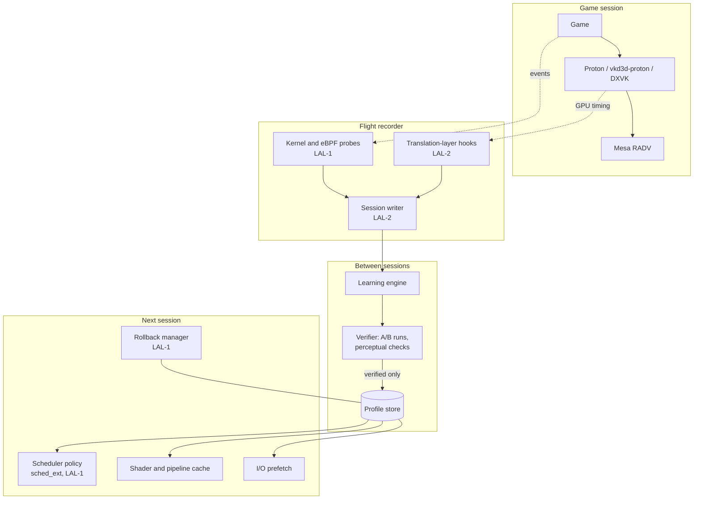

# Architecture Overview

> **Draft.** This overview describes the intended architecture. Each component's design is
> completed, and reviewed against the [Design Standard](../standards/design-standard.md), at
> gate G1 of the phase that introduces it. Nothing described here is implemented in 0.1.0
> except the process tools.

## 1. Concept

Ludus is a Linux-based gaming system that gets better at running a game the more that game
is played. It works in a loop:

1. **Record** how each session actually runs: frame times, thread scheduling, GPU passes,
   file access.
2. **Learn**, between sessions, which changes to scheduling, shader handling, memory and I/O
   would help that game on that machine.
3. **Verify** each candidate change automatically before the player ever sees it.
4. **Apply** only verified changes, and keep a single-action way back to the original.

Ludus builds on Linux, Mesa and Proton rather than replacing them
([ADR-0002](adr/0002-build-on-linux.md)). It targets AMD hardware first because the whole
graphics stack is open source ([ADR-0003](adr/0003-amd-first.md)).

## 2. Components

| Component | Responsibility | Privilege | LAL | Phase |
|---|---|---|---|---|
| Flight recorder: probes | Collect scheduling, I/O and frame events from the kernel | Kernel (eBPF) | LAL-1 | 1 |
| Flight recorder: translation-layer hooks | Collect per-pass GPU timing from the translation layer | Game process | LAL-2 | 1 |
| Flight recorder: session writer | Buffer, checksum and store session data | User | LAL-2 | 1 |
| Learning engine | Analyse sessions and propose optimizations | User | To be classified | 2 |
| Verifier | Accept or reject proposals against tier criteria | User | To be classified | 2 |
| Profile store | Keep verified per-game, per-machine profiles | User | To be classified | 2 |
| Scheduler policy | Apply per-game scheduling hints through sched_ext | Kernel (eBPF) | LAL-1 | 2 |
| Rollback manager | Restore the unmodified configuration in one action | Privileged | LAL-1 | 2 |
| Session mode | Suspend non-essential services while a game runs | Privileged | LAL-1 | 3 |

## 3. Optimization tiers

Optimizations are grouped in tiers by how much they can change what the player sees.

| Tier | Kind | Examples | Verification before use | Default |
|---|---|---|---|---|
| 1 | Lossless | Shader pre-compilation and cache warming, scheduling hints, I/O prefetch, memory placement | Output identical; frame time not worse under the SVP benchmark procedure | On |
| 2 | Perceptual | Variable-rate shading, shader simplification | Image difference below a perceptual threshold on recorded frames | Off; opt-in per game |
| 3 | Multipliers | Upscaling, frame generation, learned latency control | Perceptual threshold plus latency budget | Off; opt-in per game |
| 4 | Fleet learning | Starting from profiles verified on similar machines | Every received profile is verified again locally | Off; opt-in |

Tiers 2 and 3 are never enabled automatically for titles with competitive online play
([ADR-0006](adr/0006-perceptual-tiers-opt-in.md)).

## 4. Key properties

1. **Verified before applied.** No optimization reaches a session unless it passed its tier's
   verification (`SYS-SAF-002`, draft).
2. **Always reversible.** One user action restores the unmodified configuration
   (`SYS-SAF-001`, draft).
3. **Local by default.** Telemetry and profiles stay on the machine unless the user opts in
   (`SYS-FRC-003`).
4. **Measured, not assumed.** Recorder overhead is bounded by requirement (`SYS-FRC-002`) and
   every performance claim is measured with the reference benchmark procedure
   ([SVP](../plans/svp.md), section 9).
5. **Privilege is minimal and rigorous.** Privileged code does as little as possible and is
   developed at LAL-1 (`SYS-SEC-001`, draft).

## 5. Open design questions

These are resolved in decision records before the phase that needs them:

1. The data model and file format of session recordings (phase 1).
2. How GPU pass timing is captured with acceptable overhead in vkd3d-proton and DXVK
   (phase 1).
3. The perceptual metric and thresholds for tiers 2 and 3 (phase 3).
4. How profiles are signed and distributed for tier 4, and what data they may contain
   (phase 4).

## Revision history

| Revision | Date | Description |
|---|---|---|
| 0.1 | 2026-11-08 | Initial draft for the planning baseline 0.1.0. |
