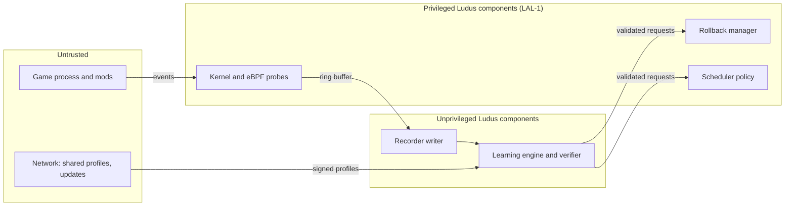

# Threat Model

> **Draft.** This threat model covers the planned architecture. It is completed and reviewed
> for each component at gate G1 of the phase that introduces it.

## 1. Purpose

This document identifies what an attacker could gain from Ludus, how, and which design
measures are planned against it. It feeds requirements in area `SEC` and `SAF` and the
design review ([SVP](../plans/svp.md), section 5.2).

## 2. Assets

| ID | Asset | Why it matters |
|---|---|---|
| A1 | Integrity of the user's system | Ludus has privileged components (kernel probes, scheduler policy, rollback manager) |
| A2 | Privacy of recorded telemetry | Telemetry reveals installed software, play habits and file paths |
| A3 | Integrity of games and their rendering | Optimizations change shaders, scheduling and resource handling |
| A4 | The user's standing with online services | Behavior that resembles cheating can lead to account bans |
| A5 | The rollback path | It is the safety net for every other failure |
| A6 | The Ludus supply chain | Source, CI, releases and shared optimization profiles |

## 3. Trust boundaries

Every arrow that enters a more trusted zone is an input that the receiving side validates.

## 4. Threats and planned mitigations

| ID | Threat | Assets | Planned mitigation | Status |
|---|---|---|---|---|
| TH-01 | An unprivileged process sends crafted requests to a privileged component to gain privileges | A1, A5 | Minimal privileged interfaces; strict validation; LAL-1 development (`SYS-SEC-001`); fuzzing of every privileged interface | Planned |
| TH-02 | A malicious or corrupted shared optimization profile executes code or crashes the GPU driver | A1, A3, A6 | Profiles carry only declarative parameters and shader intermediate code, never native binaries; signature verification; all optimizations re-verified locally before use (`SYS-SAF-002`) | Planned |
| TH-03 | Telemetry leaks personal information | A2 | Local-only by default (`SYS-FRC-003`); path redaction (`HLR-FRC-011`); explicit opt-in for sharing; documented data inventory | Requirements drafted |
| TH-04 | Recorder exhausts memory or disk | A1 | Memory limit (`HLR-FRC-006`), oldest-first discard (`HLR-FRC-007`); storage quota (to be specified) | Requirements drafted |
| TH-05 | An optimization corrupts rendering or game state | A3 | Tiered verification; perceptual checks; automatic and single-action rollback (`SYS-SAF-001`) | Planned |
| TH-06 | Ludus behavior is classified as cheating by anti-cheat software | A4 | Perceptual tiers and frame generation off by default for titles with online competitive play (ADR-0006); no code injection into game processes; documented behavior per title | Planned |
| TH-07 | Rollback state is tampered with or lost | A5 | Rollback data owned by the privileged rollback manager; integrity checks; known-good configuration always retained | Planned |
| TH-08 | Compromised dependency, CI workflow or release | A6 | Pinned dependencies; Dependabot and OSV-Scanner; code owner review of workflows; planned SHA pinning of actions (OI-004), signed tags (OI-003), Sigstore signatures and SLSA provenance | Partially in place |
| TH-09 | Malicious contribution | A1, A6 | Code owner review; independent review for LAL-1 (D-002 until a second maintainer); CI checks cannot be bypassed on `main` | Partially in place |

## 5. Out of scope

- Attacks by a user who already has administrator rights on their own machine.
- Vulnerabilities in games themselves, except where Ludus makes them easier to exploit.
- Physical attacks.

## Revision history

| Revision | Date | Description |
|---|---|---|
| 0.1 | 2026-11-08 | Initial draft for the planning baseline 0.1.0. |
